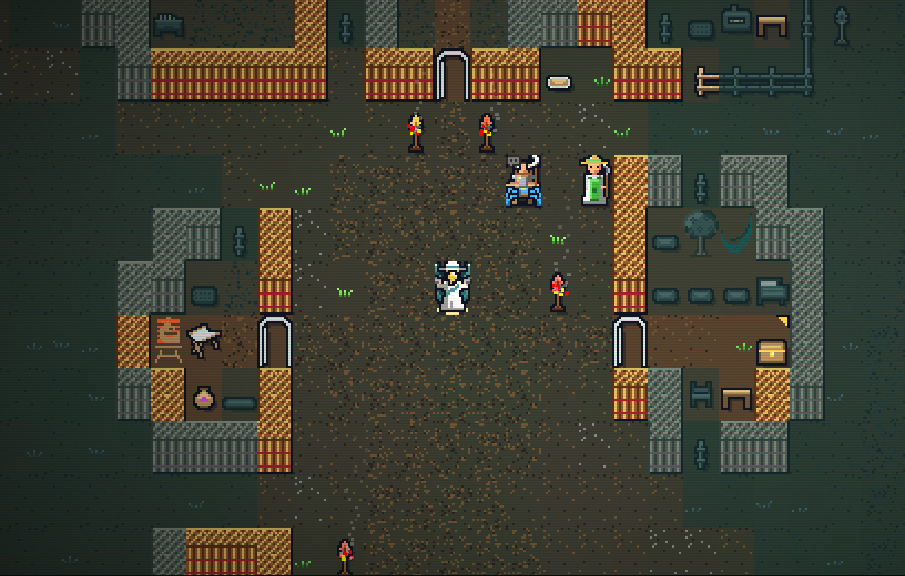
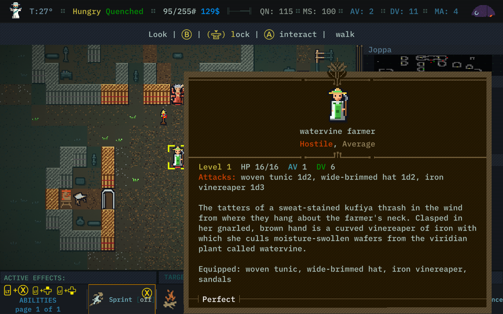
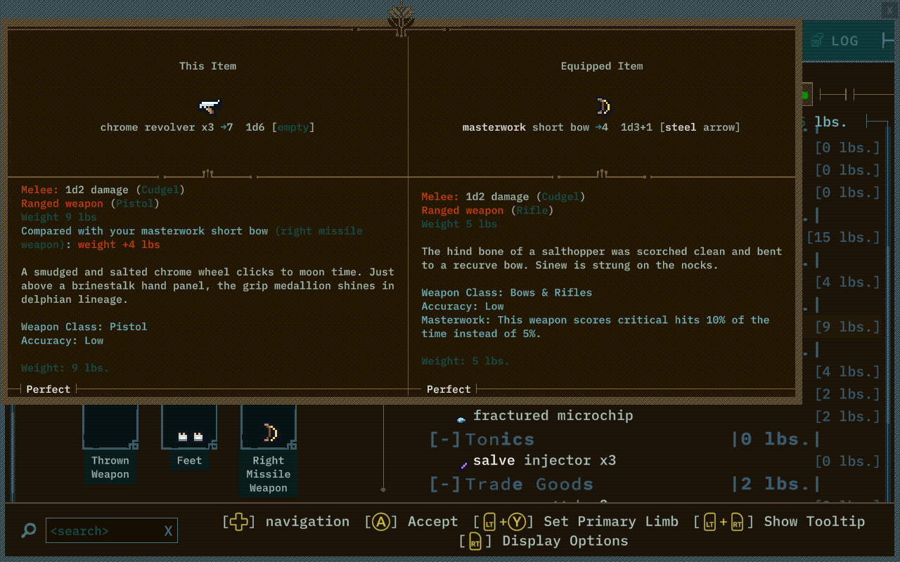
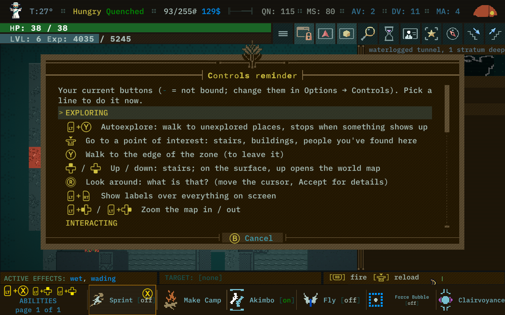
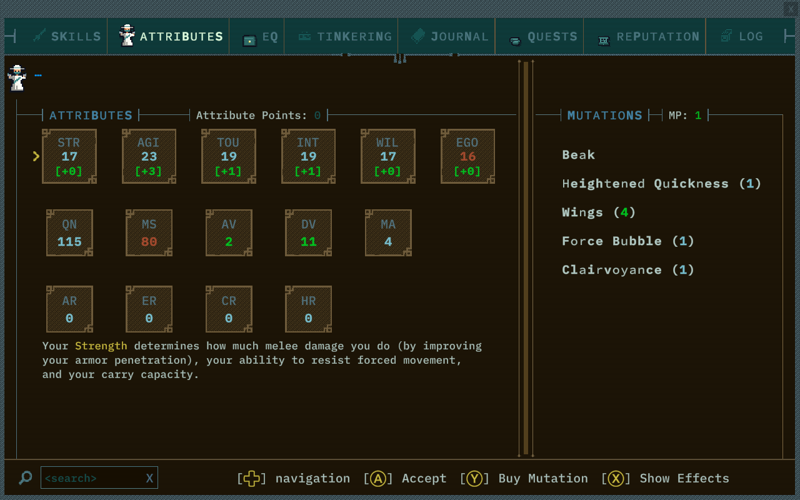

# Bright Qud

A bright, bold visual overhaul and quality-of-life mod for **Caves of Qud** (game build 2.0.211),
made on and for the **Steam Deck**, and it works on PC too.

Bold outlines, saturated colours and readability first. **Gameplay is unchanged**: Bright Qud edits
no creatures, items or stats and stores nothing in your save, so you can turn it off at any time.
Every helper below has its own switch in **Options → Mods**.

## What it does

### A new look
- **Everything is replaced**: every creature, character, item, piece of furniture and terrain tile
  the game uses has a Bright Qud version (about 3,900 tiles, ~1,700 different sprites), world map
  included.
- **New tiles** for the world: ground, walls in 3/4 view, water, plants, furniture and items.
- **Characters and monsters** redrawn in a "weird retro sci-fi" style. Snapjaws are hyena-folk,
  villagers have recognisable silhouettes, robots are chrome with glowing lights, and the hostile
  plants have maws.
- **Mutations show on characters**: horns, wings, extra arms, carapace, quills, stinger, two heads
  and more appear on human-shaped characters, including you.
- **Your colours are kept**: creatures and villages generated by the world seed keep their own
  colours, painted onto the new art.
- **Other mods' tiles get restyled**: tiles Bright Qud doesn't know (from content mods) get brighter
  colours and outlines, so the whole world matches.
- **Player look**: pick a sprite for your character (Gunslinger, Mystic, Tinker, Warden...).
- **Idle animation**: creatures bob gently and wings flap. Creature and tile animation (twinkling
  floors, glowing mushrooms) have separate switches.
- **Zones with their own look**: the Moon Stair has whole crystals made of leaning lavender shards
  on a sci-fi hexagon floor whose lights slowly twinkle; the Rainbow Wood is lush dark moss with
  tufts and tiny mushrooms, a few of them slowly glowing; Joppa sits on textured, salt-spangled earth; deserts,
  canyons, jungles and hills get calm, finely textured ground (animated tiles are off by default).
  At night and underground, torch posts and campfires cast warm pools of light, and glowing
  plants like the marsh's glowpads light the ground in their own colour. Red Rock gets
  redder rock above and a red-brown rubble floor in its caves; the Rust Wells get rust-flaked
  ground, tar-dark floors below, and fulcrete looks like bitumen with pale gravel; the jungle floor is wet loam with soft sunflecks;
  Kyakukya's houses are glossy cage-lattice fungus. Frogs, reptiles and Templars redrawn.

### Easier to read the map
| Helper | What you see |
|---|---|
| Threat rings | red ring under enemies, green under companions |
| Health bars | small bar over hurt creatures |
| Your ring | warm ring under you; it turns red and pulses when your health is low |
| Item sparkle | items lying on the ground twinkle |
| Talk bubbles | speech bubble over merchants and named characters; it fades once you've talked |
| Gold corners | stairs and containers that still hold items (F6 turns these and the sparkle off/on) |
| Clear memory | remembered areas (out of sight, or too dark to see) are dimmer but keep their colours |
| Coloured ground | real ground colours instead of black |
| Fire and effects | flames drawn on burning things; no black squares behind gas, explosions or thrown items |
| World map danger | regions too dangerous for your level are tinted orange (hard) or red (deadly); look at a region to see its level. World-map colours are toned down. |

### Easier to read the menus
- **Clearer font**: *Clear mono* (detailed and aligned) or *Readable* (Atkinson Hyperlegible, made
  for low vision), or keep the game's own font.
- **Interface colours** *(experimental)*: Qud teal (default), Tan parchment (light), Amber, Rust,
  Violet, Slate.
- **Key stats at a glance**: looking at or hovering over things puts a short summary on top of the
  description.
  - Monsters: level, HP, AV/DV, attacks with damage, ranged weapon, mutations.
  - Each mutation and fight skill gets a one-line explanation, red if it's dangerous to you
    (e.g. `Freezing Ray - ranged cold beam, can freeze you solid`), plus a status line
    (on fire, stunned...).
  - Items: damage, penetration, armour, resistances, charge, liquid contents, weight.
  - Unidentified items stay unspoiled.
- **Quest helper**: LT + left stick click (or F4) lists your quests, nearest first, with the next
  step and roughly where it is ("3 regions NE"). Pick one to follow: a small banner under the status
  bar keeps showing what to do next. Nothing is stored in your save.
- **Item comparison**: weapons, armour and shields show the difference with what you wear in that
  slot, in green (better) or red (worse), e.g. `[AV +1 DV -1]` or `[dmg +1.5]`. It works in the
  inventory, when picking things up, and at merchants. The description adds a
  "Compared with your …" line.
- **Ability bar**: more abilities fit at once (*More* / *Most*), so there's less paging. Pointing at an
  ability, or selecting it with the controller, shows what it does, its cooldown and whether it's on.
- **Controls reminder** (LT + View, or F3): the most useful commands for a playthrough on a gamepad.
  Pick one to use it.
- **Legend**: what every marker and colour means (Options → Mods → "show legend").

## Screenshots
| | |
|---|---|
|  |  |
| Key stats on top of the description | Item comparison with what you wear |
|  |  |
| Controls reminder (LT + View) | Amber interface colours and the Clear mono font |

## Install
- **Steam Workshop**: https://steamcommunity.com/sharedfiles/filedetails/?id=3825185564 (subscribe, then enable it in the Mods menu).
- **Manually**: copy the `mod/BrightQud` folder into your Caves of Qud mods folder, then enable
  "Bright Qud" in the game's Mods menu and restart.
  - Linux / Steam Deck: `~/.config/unity3d/Freehold Games/CavesOfQud/Mods/`
  - Windows: `%USERPROFILE%\AppData\LocalLow\Freehold Games\CavesOfQud\Mods\`

## Compatibility
Bright Qud uses only visual and UI Harmony patches, and every patch fails safely. Content mods work:
their creatures and items get the automatic restyle. Other tile packs that replace the same tile
files: whichever loads last wins for each tile. Details: [docs/COMPATIBILITY.md](docs/COMPATIBILITY.md).

## For modders / contributors
- The art is written as text grids in `art/src/*.py` (16×24 tiles with recolourable roles) and
  built by `tools/build_mod.py`.
- The runtime is C# with Harmony in `mod/BrightQud/*.cs`. How it works:
  [docs/ARCHITECTURE.md](docs/ARCHITECTURE.md).
- Building the tiles needs your own extracted game tiles in `reference/`. They are never part of
  this repository.

## Licence
- Art: [CC BY-NC-SA 4.0](https://creativecommons.org/licenses/by-nc-sa/4.0/).
- Code: MIT. See [LICENSE.txt](LICENSE.txt).
- Fonts: Atkinson Hyperlegible (Braille Institute) and IBM Plex Mono (IBM), both under the SIL Open
  Font License (`mod/BrightQud/Fonts/`).
- Bright Qud contains no game assets. Caves of Qud is © Freehold Games; this is a fan mod.

Made by **mverdide**.
